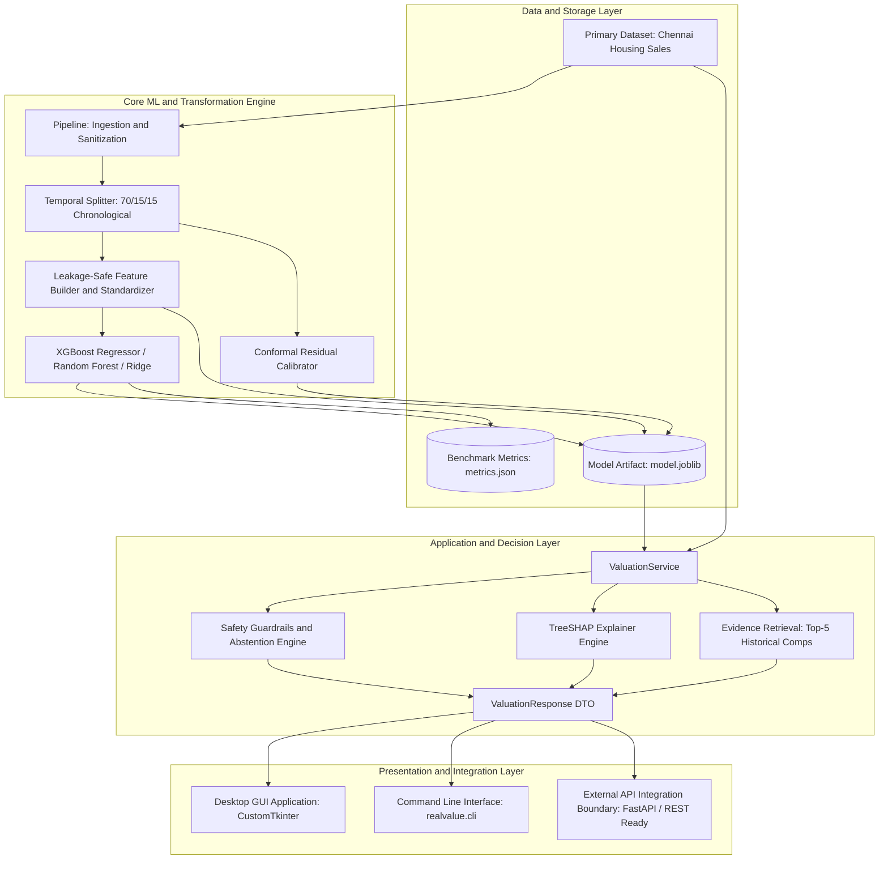
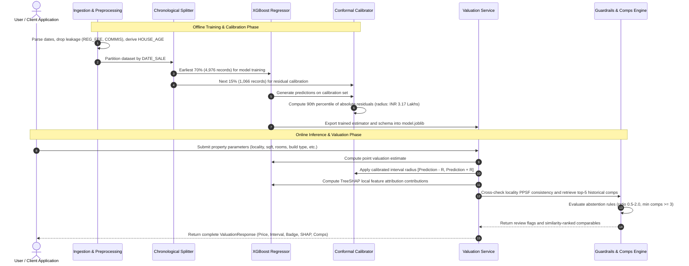

# RealValue AI: Explainable Chennai Property Valuation Engine

An enterprise-grade, explainable, and trust-aware property valuation system tailored for the Chennai residential real estate market. RealValue AI combines gradient-boosted regression with distribution-free conformal uncertainty intervals, TreeSHAP feature attribution, rule-based safety abstention, and an interactive desktop demonstration suite.

---

## Table of Contents

- [Overview](#overview)
- [Key Features](#key-features)
- [System Architecture](#system-architecture)
- [End-to-End Workflow](#end-to-end-workflow)
- [Model Performance and Benchmarks](#model-performance-and-benchmarks)
- [Safety, Trust, and Abstention Guardrails](#safety-trust-and-abstention-guardrails)
- [Explainability and Comparable Evidence](#explainability-and-comparable-evidence)
- [Repository Structure](#repository-structure)
- [Installation and Setup](#installation-and-setup)
- [Usage Guide](#usage-guide)
  - [Desktop GUI Application](#desktop-gui-application)
  - [Command Line Interface (CLI)](#command-line-interface-cli)
  - [Python Service API](#python-service-api)
- [Data Governance and Leakage Prevention](#data-governance-and-leakage-prevention)
- [Limitations and Roadmaps](#limitations-and-roadmaps)

---

## Overview

Automated Valuation Models (AVMs) often operate as opaque black boxes, delivering point estimates without confidence bounds or explanations. RealValue AI addresses these deficiencies by offering:

1. **High Precision Estimation**: Extreme Gradient Boosting (XGBoost) achieving a 1.22% Mean Absolute Percentage Error (MAPE) on strictly chronological test splits.
2. **Distribution-Free Uncertainty**: 90% split-conformal prediction intervals providing empirical coverage guarantees without Gaussian or homoscedastic assumptions.
3. **Transparent Explainability**: Local TreeSHAP additive feature contributions illustrating exactly why a property is valued above or below market baseline.
4. **Automated Safety Guardrails**: Proactive abstention mechanisms that flag anomalous valuations, extreme extrapolations, or thin local market evidence for human appraisal review.
5. **Interactive Demonstration**: A standalone CustomTkinter desktop interface featuring real-time sensitivity sliders, embedded Matplotlib waterfall visualizations, top-5 nearest comparable sales, and benchmark diagnostic cards.

---

## Key Features

- **Chronologically Validated Model**: Trained and evaluated using chronological splits (earliest 70% train, subsequent 15% calibration, final 15% test) to prevent temporal data leakage.
- **Conformal Uncertainty Bands**: Dynamic prediction intervals (typically plus/minus 3.17 Lakhs INR) calibrated on held-out residual distributions.
- **TreeSHAP Attributions**: Exact tree-path feature importance showing positive and negative price drivers for every prediction.
- **Nearest Historical Comparables**: Weighted distance-based retrieval that identifies the top 5 most similar historical transactions within the same locality.
- **Self-Governing Review Flags**: Flags valuations that diverge materially (ratio outside 0.5 to 2.0) from locality price-per-square-foot benchmarks or lack sufficient comparables.
- **Cross-Model Diagnostics**: Side-by-side benchmark comparison cards evaluating XGBoost against Random Forest, Ridge Regression, and the Training Median Baseline.
- **Decoupled Architecture**: Zero-GUI-dependency core engine (`ValuationService`), ready for headless batch processing, CLI execution, or web microservice deployment.

---

## System Architecture

RealValue AI follows a layered, modular architecture that isolates data transformation, statistical modeling, inference orchestration, and presentation layers.



### Architectural Components

1. **Data and Artifact Layer**:
   - `Chennai houseing sale.csv`: Historical dataset containing 7,109 residential transactions between 2004 and 2015.
   - `model.joblib`: Serialized, self-contained deployment bundle containing the trained estimator, feature schemas, imputation values, standardization statistics, conformal calibration quantiles, and locality price-per-sqft baselines.
   - `metrics.json`: Versioned benchmark evaluation metrics across baseline, linear, ensemble, and boosted architectures.

2. **Core ML and Transformation Engine (`realvalue.pipeline`, `realvalue.model`)**:
   - Tabular feature pipeline executing strict categorical one-hot encoding and robust numerical standard scaling.
   - Prevention of target leakage by omitting transaction fees (`REG_FEE`), agent commissions (`COMMIS`), and raw IDs.
   - `TabularValuator` abstraction providing unified `fit`, `predict`, `calibrate`, `explain`, and serialization interfaces.

3. **Application and Decision Layer (`realvalue.service`)**:
   - `ValuationService`: Main business facade coordinating prediction generation, interval calculation, explainability extraction, and safety validation.
   - `ValuationResponse`: Immutable Data Transfer Object (DTO) returning the point prediction, interval bounds, trust flags, explanation drivers, nearest historical comps, and locality consistency ratios.

4. **Presentation and Integration Layer (`realvalue.gui_app`, `realvalue.cli`)**:
   - Responsive multi-pane desktop client built with CustomTkinter.
   - Scriptable CLI supporting schema profiling, end-to-end model training, single-record valuation, and bulk CSV batch processing.

---

## End-to-End Workflow

The workflow encompasses the complete lifecycle from raw historical records to real-time, explainable property appraisals:



### Detailed Workflow Stages

1. **Sanitization and Feature Derivation**:
   - Date formats are standardized. `HOUSE_AGE` is computed dynamically as the difference between transaction date (`DATE_SALE`) and construction date (`DATE_BUILD`).
   - Categorical locality variants and typos are handled cleanly without unverified silent merges.
   - Missing numerical features (e.g., bathroom and bedroom counts, overall quality scores) are imputed using medians calculated solely from training partitions.

2. **Strict Chronological Splitting**:
   - Records are sorted in ascending order of transaction date (`DATE_SALE`).
   - First 70% (4,976 transactions up to 2011-06-12) forms the training set.
   - Subsequent 15% (1,066 transactions from 2011-06-13 to 2012-03-22) forms the calibration set.
   - Final 15% (1,067 transactions from 2012-03-23 to 2015-02-17) serves as the unseen test evaluation set.

3. **Ensemble Training and Conformal Calibration**:
   - XGBoost Regressor fits the training split using gradient boosted trees (500 estimators, max depth 5, learning rate 0.04).
   - Predictions are computed on the held-out calibration set. Absolute residuals are ordered to find the finite-sample empirical quantile corresponding to nominal 90% coverage:

     ```text
     Residual_Quantile_90 = Empirical_Quantile(|y_true - y_pred|, ceil((N + 1) * 0.90) / N)
     ```

   - This yields a calibrated uncertainty radius of plus/minus 3.17 Lakhs INR.

4. **Inference, Safety Verification, and Evidence Retrieval**:
   - Given an input property profile, the engine outputs the predicted market value and 90% confidence bounds.
   - The safety engine verifies if the predicted price per square foot aligns with historical median values for that specific locality.
   - The evidence retrieval engine performs multi-attribute similarity ranking against historical sales, selecting the top 5 closest comps.
   - If significant anomalies or low locality support are identified, the system tags the output with an abstention flag (`confidence_flag: review`) requiring human appraiser oversight.

---

## Model Performance and Benchmarks

All models were evaluated on the exact same 15% unseen chronological test split (1,067 transactions from March 2012 to February 2015).

| Model Architecture | Test MAE (INR) | Test RMSE (INR) | Test MAPE (%) | 90% Calibrated Radius | Test Coverage (%) | Mean Interval Width |
|---|---:|---:|---:|---:|---:|---:|
| **Training Median Baseline** | 31,61,303 | 42,81,174 | ~28.4% | Not Applicable | Not Applicable | Not Applicable |
| **Ridge Regression** | 6,90,719 | 9,21,542 | 5.29% | 14,02,371 | 89.41% | 28,04,743 |
| **Random Forest Regressor** | 3,64,378 | 4,68,077 | 3.11% | 8,61,410 | 93.63% | 17,22,821 |
| **XGBoost Regressor (Selected)** | **1,51,739** | **2,15,754** | **1.22%** | **3,17,302** | **89.03%** | **6,34,604** |

### Benchmark Observations

- **Superior Accuracy**: XGBoost cuts the Mean Absolute Error to 1.51 Lakhs INR (compared to 3.64 Lakhs for Random Forest and 31.61 Lakhs for naive median estimation).
- **Narrow Prediction Intervals**: XGBoost delivers an average 90% conformal interval width of 6.35 Lakhs INR (plus/minus 3.17 Lakhs), less than half the interval width of Random Forest (17.23 Lakhs) and less than a quarter of Ridge Regression (28.05 Lakhs).
- **Empirical Coverage Validation**: The 90% nominal conformal calibration achieves an empirical test coverage of 89.03%, demonstrating excellent calibration fidelity on temporal test sets.

---

## Safety, Trust, and Abstention Guardrails

To prevent high-stakes errors and unwarranted overconfidence, RealValue AI incorporates a multi-layer guardrail framework:

1. **Locality Consistency Ratio**:
   - Compares the predicted price against the locality benchmark: `Benchmark = Locality_Median_PPSF * Floor_Area`.
   - If `Prediction / Benchmark < 0.5` or `Prediction / Benchmark > 2.0`, the property is flagged:
     *"Prediction differs materially from historical locality price-per-square-foot scale"*.
2. **Evidence Density Verification**:
   - The engine searches historical records for matching transactions in the same area.
   - If fewer than 3 comparable transactions exist, the property is flagged:
     *"Fewer than three comparable transactions"*.
3. **Out-of-Bounds Dimension Checks**:
   - Floor area values (`INT_SQFT`) less than or equal to 0 or missing are flagged:
     *"Missing or invalid floor area"*.
   - Unrecognized locality names without historical pricing data are flagged:
     *"No historical locality benchmark"*.
4. **Transparent Abstention Status**:
   - Standard predictions output `confidence_flag: "standard"` and `abstained: false`.
   - Flagged predictions output `confidence_flag: "review"` and `abstained: true`, alongside a list of explicit human-readable reasons in `review_reasons`.

---

## Explainability and Comparable Evidence

RealValue AI emphasizes interpretability alongside numerical accuracy:

### Local TreeSHAP Feature Attributions
For every prediction, the engine uses XGBoost's fast tree-contribution algorithm (`pred_contribs=True`) to derive exact additive Shapley contributions for each feature. The desktop GUI renders these as an embedded Matplotlib waterfall chart illustrating:
- Features exerting upward pressure on property value (e.g., larger square footage, premium localities such as Anna Nagar or T Nagar, commercial zoning).
- Features exerting downward pressure on property value (e.g., older building age, remote street access, agricultural zoning).

### Multi-Attribute Comparable Sales Engine
The system retrieves and ranks historical transactions using a weighted attribute distance metric:

```text
Distance = 0.30 * d(SQFT) + 0.15 * d(Bedrooms) + 0.10 * d(Bathrooms) + 0.10 * d(Rooms) + Categorical_Penalties
```

Comparables display property IDs, total square footage, historical sale price, transaction price per square foot, and calculated similarity scores.

---

## Repository Structure

```text
RealValue/
├── artifacts/
│   ├── metrics.json             # Cross-model evaluation and benchmark metrics
│   └── model.joblib             # Serialized XGBoost bundle and calibration data
├── data/
│   └── Chennai houseing sale.csv# Primary historical transactions dataset (7,109 rows)
├── docs/
│   ├── DATA_AUDIT.md            # Multi-file dataset audit and inclusion decisions
│   └── ROADMAP.md               # Architecture milestones, scope, and technical boundary
├── realvalue/
│   ├── __init__.py              # Package entry point
│   ├── cli.py                   # Command-line interface subcommands (profile, train, value, batch)
│   ├── gui_adapter.py           # GUI data binding and service abstraction adapter
│   ├── gui_app.py               # Main CustomTkinter desktop interface controller
│   ├── gui_components.py        # Custom UI widgets (sliders, cards, diagnostics hubs)
│   ├── gui_evidence.py         # Matplotlib SHAP waterfall charts and comps list cards
│   ├── model.py                 # TabularValuator, model estimators, and bundle serializer
│   ├── pipeline.py              # Ingestion, validation, and chronological splitters
│   └── service.py               # ValuationService, ValuationResponse DTO, and guardrails
├── tests/
│   ├── test_evidence_components.py
│   ├── test_gui_adapter.py
│   ├── test_gui_app.py
│   ├── test_presets_and_diagnostics.py
│   └── test_valuation_form.py
├── model_summary.txt            # High-level model summary and evaluation highlights
├── requirements.txt             # Python package dependencies
├── run_gui.py                   # Root runner for launching the desktop application
└── README.md                    # Project documentation
```

---

## Installation and Setup

### Prerequisites

- Python 3.10 or higher
- PowerShell, Command Prompt, or Bash
- Standard scientific Python libraries

### Setup Instructions

1. Clone or download the repository to your local system:
   ```bash
   git clone https://github.com/your-username/RealValue.git
   cd RealValue
   ```

2. Create and activate an isolated virtual environment:
   ```powershell
   python -m venv venv
   .\venv\Scripts\Activate.ps1
   ```
   *(On macOS/Linux: `source venv/bin/activate`)*

3. Install project dependencies:
   ```bash
   python -m pip install --upgrade pip
   python -m pip install -r requirements.txt
   ```

---

## Usage Guide

### Desktop GUI Application

Launch the desktop demonstration suite with a single command:

```powershell
python run_gui.py
```

The GUI suite includes:
- **Interactive Valuation Controls**: Modify locality, interior square footage, bedroom count, room counts, building type, utility availability, municipal zone, and quality ratings.
- **Instant Valuation Display**: Real-time price prediction in INR (formatted in Lakhs / Crores) with a 90% split-conformal confidence interval.
- **Dynamic Trust Badge**: Real-time badge indicating `Standard` or `Under Review` based on automated safety guardrails.
- **Embedded SHAP Waterfall Visualizer**: Interactive Matplotlib chart visualizing the top positive and negative feature drivers.
- **Historical Sales Explorer**: Detailed cards displaying the top 5 nearest historical sales with similarity metrics and price/sqft.
- **One-Click Scenario Presets**: Preloaded scenarios to test Luxury Villas, Commercial Hubs, Budget Flats, and edge-case abstention triggers with a single click.
- **Model Diagnostics Hub**: Side-by-side benchmark comparison cards evaluating XGBoost against Random Forest, Ridge, and Training Median.

---

### Command Line Interface (CLI)

RealValue AI includes a full-featured CLI for data profiling, training, single-record valuation, and bulk batch processing.

#### 1. Dataset Profiling
Inspect dataset health, row counts, null values, and locality breakdowns:
```powershell
python -m realvalue.cli profile --data "data/Chennai houseing sale.csv"
```

#### 2. Model Training and Bundle Generation
Execute chronological splitting, model benchmarking, conformal residual calibration, and bundle export:
```powershell
python -m realvalue.cli train --data "data/Chennai houseing sale.csv" --artifacts artifacts
```

#### 3. Single Record Valuation
Evaluate a specific row from a CSV dataset:
```powershell
python -m realvalue.cli value --model artifacts/model.joblib --data "data/Chennai houseing sale.csv" --row 0
```

#### 4. Batch Processing
Perform batch property valuation across an entire CSV of requests:
```powershell
python -m realvalue.cli batch --model artifacts/model.joblib --input requests.csv --history "data/Chennai houseing sale.csv" --output valuations.csv
```

---

### Python Service API

Integrate `ValuationService` directly into Python services, scripts, or web endpoints (e.g., FastAPI, Flask):

```python
import joblib
import pandas as pd
from realvalue.model import TabularValuator
from realvalue.service import ValuationService

# 1. Load fitted model bundle and historical records
model = TabularValuator.load("artifacts/model.joblib")
historical_data = pd.read_csv("data/Chennai houseing sale.csv")

# 2. Instantiate valuation service
service = ValuationService(model=model, historical=historical_data)

# 3. Submit property valuation query
request = {
    "AREA": "Anna Nagar",
    "INT_SQFT": 1850,
    "DIST_MAINROAD": 45,
    "N_BEDROOM": 3,
    "N_BATHROOM": 2,
    "N_ROOM": 5,
    "SALE_COND": "Normal Sale",
    "PARK_FACIL": "Yes",
    "BUILDTYPE": "Commercial",
    "UTILITY_AVAIL": "AllPub",
    "STREET": "Paved",
    "MZZONE": "RH",
    "QS_ROOMS": 4.2,
    "QS_BATHROOM": 4.0,
    "QS_BEDROOM": 3.8,
    "QS_OVERALL": 4.0,
    "DATE_SALE": "15-05-2014",
    "DATE_BUILD": "15-05-2004",
}

response = service.value(request)

# 4. Access structured response fields
print(f"Estimated Price: INR {response.estimated_price:,.2f}")
print(f"90% Prediction Interval: [INR {response.interval_low:,.2f}, INR {response.interval_high:,.2f}]")
print(f"Confidence Status: {response.confidence_flag.upper()} (Abstained: {response.abstained})")
print("Top Positive/Negative Feature Drivers:", response.explanation[:3])
print(f"Nearest Historical Comparables Found: {len(response.comparables)}")
```

Sample JSON response output structure:

```json
{
  "estimated_price": 14250320.0,
  "interval_low": 13933018.0,
  "interval_high": 14567622.0,
  "currency": "INR",
  "confidence_flag": "standard",
  "abstained": false,
  "review_reasons": [],
  "explanation": [
    {"feature": "INT_SQFT", "contribution": 3812490.5, "method": "TreeSHAP"},
    {"feature": "AREA_Anna Nagar", "contribution": 1945120.0, "method": "TreeSHAP"},
    {"feature": "BUILDTYPE_Commercial", "contribution": 1420800.0, "method": "TreeSHAP"}
  ],
  "comparables": [
    {
      "property_id": "P03421",
      "locality": "Anna Nagar",
      "area_sqft": 1820,
      "sale_price": 14100000,
      "price_per_sqft": 7747.25,
      "similarity_score": 0.042
    }
  ],
  "consistency": {
    "locality_median_price_per_sqft": 7820.5,
    "benchmark_value": 14467925.0,
    "prediction_to_benchmark_ratio": 0.985
  },
  "model_version": "xgboost-mvp-2"
}
```

---

## Data Governance and Leakage Prevention

### Primary Source Scope
The model is trained strictly on `Chennai houseing sale.csv` (7,109 validated transactions). Additional datasets present in the workspace are purposefully quarantined:
- `chennai-properties.csv` (699 rows): Contains listing asking prices, not finalized transaction settlement prices.
- `Real estate.csv` (414 rows): Describes a Taiwan housing market with different geographic and currency regimes.
- `clean_data.csv` (6,617 rows): Contains forestry and tree biomass records; excluded from real estate processing.

### Target Leakage Prevention Policy
- Transaction registration fees (`REG_FEE`) and broker commission fees (`COMMIS`) are strictly excluded from model feature sets, as they directly encode post-transaction settlement amounts.
- Primary keys (`PRT_ID`) and arbitrary identifiers are removed prior to training.
- Property age is computed solely with respect to the transaction date to prevent temporal target lookahead.

---

## Limitations and Roadmaps

### Current Scope & Known Limitations
- **Historical Horizon**: The training dataset spans transactions between 2004 and 2015. Predictions reflect historical rupee market baselines and must not be used as uncalibrated present-day market quotes without inflation adjustment.
- **Granular Geography**: Spatial coordinates (latitude/longitude), proximity to transit stations, and school boundary shapefiles were not present in the historical records; locality features rely on municipal zone and neighborhood labels.
- **Rule-Based Abstention**: The review flag serves as a conservative heuristic guardrail rather than a calibrated Bayesian posterior probability of error.

### Planned Enhancements
- Geospatial enrichment using OpenStreetMap APIs for point-of-interest and transit proximity metrics.
- Multi-head temporal calibration adapting conformal bounds dynamically to macroeconomic real estate inflation trends.
- Containerized microservice deployment with FastAPI, Prometheus telemetry, and automated model drift monitors.

---

## License

This project is licensed under the MIT License. See `LICENSE` for details.
